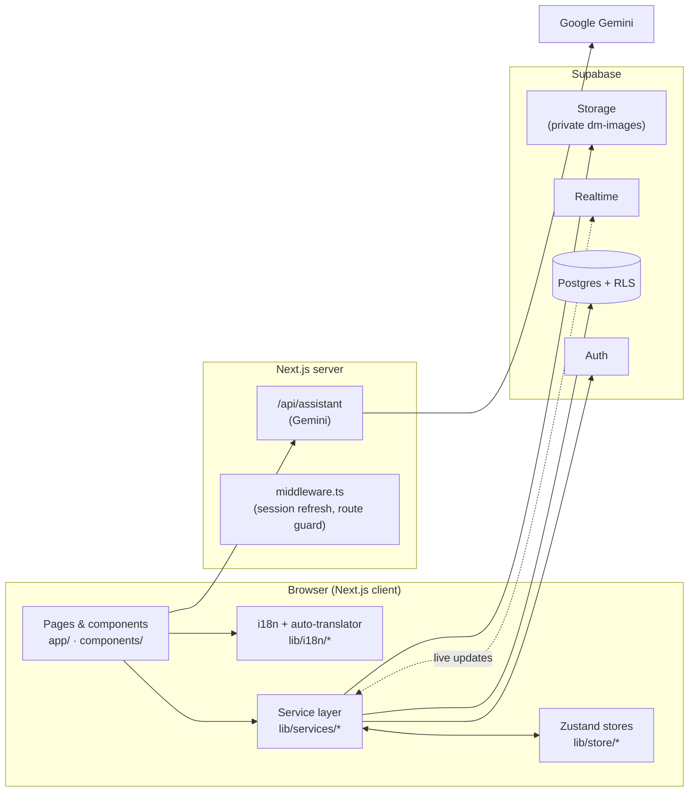

<div align="center">


# Musubi（結び）

**Connecting the wisdom of the past with the energy of today.**

A bilingual (English / 日本語) community platform for Nagasaki that connects older and younger neighbours to share skills, help each other with everyday tasks, and build lasting friendships.

[](https://musubi-asmr.vercel.app)
[](https://nextjs.org/)
[](https://www.typescriptlang.org/)
[](https://supabase.com/)
[](https://tailwindcss.com/)
[](#-testing)

[Live demo](https://musubi-asmr.vercel.app) · [Features](#-features) · [Getting started](#-getting-started) · [Architecture](#-architecture) · [Testing](#-testing)

</div>

---

## 📖 Table of contents

- [Overview](#-overview)
- [Features](#-features)
- [Tech stack](#-tech-stack)
- [Architecture](#-architecture)
- [Getting started](#-getting-started)
- [Environment variables](#-environment-variables)
- [Database setup](#-database-setup)
- [Available scripts](#-available-scripts)
- [Testing](#-testing)
- [Internationalisation](#-internationalisation)
- [Security & privacy](#-security--privacy)
- [Accessibility](#-accessibility)
- [Deployment](#-deployment)
- [Contributing](#-contributing)
- [Contributors](#-contributors)

---

## 🌸 Overview

Japan's ageing society leaves many older residents isolated, while younger people often lack local roots and traditional knowledge. **Musubi**（結び, *"tying together"*）is a two-way exchange: older members share cooking, calligraphy, origami and local history; younger members help with smartphones, video calls, errands and heavy lifting — and everyone gains company.

| | |
| --- | --- |
| **Who it's for** | Neighbours in Nagasaki aged 15+, grouped as **Older Generation (60+)** and **Younger Generation (under 60)** |
| **How it works** | Post a need or an offer → a neighbour responds → accept and chat privately → meet in a public place → both confirm completion → leave a review |
| **Design focus** | Large text, big tap targets, minimal typing, a voice-enabled assistant and full Japanese support — usable by people who are new to technology |

---

## ✨ Features

### Community exchange
- **Posts** with category, skill, location, availability and exchange type — **Free**, **Skill Exchange** or **Paid (Demo)**.
- **Quick Post wizard** — four guided steps with ready-made templates; almost no typing.
- **Standard Post** for writing every detail yourself, with a profile-completion gate so neighbours always know who is asking.
- **Browse & search** posts and people with filters (category, area, availability, generation, exchange type) and *See more / See less* pagination.
- **Approximate-location maps** (Leaflet + OpenStreetMap) on every post.

### Working together
- **Service requests** — respond to a post, then the owner accepts or declines.
- **Real-time chat** per accepted request, with quick replies and read-aloud.
- **Two-party completion** — both members confirm before an exchange is finished.
- **Pay-then-complete demo payments** — on paid posts the payer completes a simulated payment in a popup before marking the task done (no real money ever moves).
- **Reviews & ratings**, transaction history, and a **My Activity** hub (posts, requests, in progress, completed, transactions).

### Social connections
- **Connections** like a social network — send, accept, decline, cancel, remove and **block**.
- **Private messages** between connections, separate from post chats: edit, delete for everyone, emoji reactions, and photos that are **resized in the browser** before upload to private storage.
- **LinkedIn-style profile stats** — connection count, mutual connections, completed exchanges and rating.

### Profiles
- **Your own location** via GPS or by tapping a map — stored only as an approximate (~1 km) area.
- **Availability** presets plus **custom dates & times** (day / month / year, from–until).
- Skills, needs, interests, neighbourhoods, avatar and contact preference (chat or consented phone).

### Help, safety & accessibility
- **Musubi Guide** — an assistant that answers FAQs instantly offline (EN/JA) and uses **Google Gemini** for finding helpers and drafting posts; supports voice input and spoken replies.
- **Report & block** on every post and profile; blocked members disappear from search, chat and connections.
- **Full English ⇄ Japanese switch**, larger-text mode, notifications with sound and badges.
- **Accounts** — email/password and Google sign-in, forgot/reset/change password, minimum age 15.

---

## 🧰 Tech stack

| Layer | Technology |
| --- | --- |
| Framework | [Next.js 14](https://nextjs.org/) (App Router) · React 18 · TypeScript 5 |
| Styling | Tailwind CSS 3 · Radix UI primitives · lucide-react icons |
| State | Zustand (persisted client cache) |
| Forms & validation | React Hook Form · Zod |
| Backend | [Supabase](https://supabase.com/) — PostgreSQL with Row Level Security, Auth (email + Google OAuth), Realtime, Storage |
| Maps | Leaflet · React Leaflet · OpenStreetMap / Nominatim |
| AI assistant | Google Gemini via `@google/genai` (server route) with an offline bilingual FAQ matcher |
| Testing | Vitest (unit + integration) · Playwright (end-to-end regression) |
| Hosting | Vercel |

---

## 🏗 Architecture



**Key design decisions**

- **Service layer** — components never talk to Supabase directly; every read/write goes through `lib/services/*`, which maps database rows to the domain types in `lib/types.ts`.
- **Row Level Security everywhere** — members can only read their own requests, chats, activities, connections and messages. Public aggregates (connection and completed-exchange counts) are exposed through narrow `SECURITY DEFINER` functions that return numbers only.
- **Optimistic UI + realtime** — messages, reactions and connections update instantly and reconcile with Supabase Realtime, with polling as a fallback.
- **Client-generated UUIDs** for inserts addressed to other users (notifications, reports), so RLS-restricted read-backs never fail an insert.

<details>
<summary><b>Project structure</b></summary>

```text
.
├── app/                       # Next.js App Router pages
│   ├── api/assistant/         # Gemini-backed assistant endpoint
│   ├── posts/ quick-post/     # Browse, detail (map), Standard & Quick Post
│   ├── search/                # Posts & people search
│   ├── requests/ chat/        # Service requests and per-request chat
│   ├── my-activity/ transactions/ feedback/
│   ├── connections/           # Connections hub + private messages (chat/[id])
│   ├── profile/               # Public profile & edit (location, availability)
│   ├── notifications/ about/
│   └── login/ register/ onboarding/ forgot-password/ reset-password/ change-password/
├── components/
│   ├── ui/                    # Button, Card, Input, Dialog, Badge
│   ├── common/                # Header, Footer, BottomNav, AuthGuard, AutoTranslator…
│   ├── posts/ search/ chat/ connections/ transactions/ profile/ maps/
│   ├── assistant/             # Musubi Guide widget
│   └── notifications/         # Bell, messenger menu, toasts
├── lib/
│   ├── services/              # Auth, posts, requests, chat, connections, DMs, payments…
│   ├── store/                 # Zustand stores
│   ├── i18n/                  # Translations, EN→JA dictionary, auto-translator
│   ├── assistant/             # Bilingual FAQ + matcher, speech helpers
│   ├── validators/            # Zod schemas
│   └── availability.ts geo.ts imageResize.ts profileCompletion.ts constants.ts types.ts
├── supabase/
│   ├── schema.sql             # Base schema, RLS policies, triggers, templates
│   └── migrations/            # Incremental changes (run in date order)
├── tests/                     # unit/ · integration/ · e2e/
└── middleware.ts              # Supabase session refresh + protected routes
```

</details>

---

## 🚀 Getting started

### Prerequisites

- **Node.js 18.17+** (20 LTS recommended) and npm
- A free **[Supabase](https://supabase.com/)** project
- *(Optional)* a **Google Gemini API key** for the AI parts of the assistant
- *(Optional)* Google OAuth credentials for "Continue with Google"

### Installation

```bash
git clone git@github.com:fariha-rahman-saba/hackathon.git
cd hackathon
npm install
cp .env.example .env.local   # or create .env.local — see below
```

Set up the database ([below](#-database-setup)), then start the app:

```bash
npm run dev
```

Open **http://localhost:3000**.

---

## 🔐 Environment variables

Create **`.env.local`** in the project root (it is git-ignored — never commit it).

| Variable | Required | Description |
| --- | :---: | --- |
| `NEXT_PUBLIC_SUPABASE_URL` | ✅ | Supabase project URL (*Project Settings → API*) |
| `NEXT_PUBLIC_SUPABASE_ANON_KEY` | ✅ | Supabase anon / publishable key |
| `GEMINI_API_KEY` | ➖ | Google Gemini key for the assistant's AI answers. Without it, FAQ answers still work offline. Server-side only. |
| `GEMINI_MODEL` | ➖ | Comma-separated model fallback list to override the default chain |

```bash
NEXT_PUBLIC_SUPABASE_URL=https://your-project.supabase.co
NEXT_PUBLIC_SUPABASE_ANON_KEY=your-anon-key
GEMINI_API_KEY=your-gemini-key
```

---

## 🗄 Database setup

In the Supabase dashboard open **SQL Editor** and run these files **in order** (all are idempotent and safe to re-run):

| # | File | Adds |
| --- | --- | --- |
| 1 | `supabase/schema.sql` | Core tables (profiles, posts, requests, chat, notifications, transactions, reviews, activities, reports, blocks), RLS policies, sign-up trigger, Quick Post templates |
| 2 | `supabase/migrations/20261124_connections_and_direct_messages.sql` | Connections, private messages, reactions, realtime, private `dm-images` storage bucket |
| 3 | `supabase/migrations/20261124_profile_connection_counts.sql` | `connection_count()` and `mutual_connections()` |
| 4 | `supabase/migrations/20261125_completed_exchange_count.sql` | `completed_exchange_count()` for public profile stats |

**Authentication settings** (*Authentication → URL Configuration*): set the **Site URL** to your deployment and add `http://localhost:3000/**` to **Redirect URLs** so password-reset and Google sign-in links return to the app. Enable the Google provider under *Authentication → Providers* if you want Google sign-in.

> **Demo accounts.** The login page offers one-click demo sign-in for `haruko.sato@tsunagu.demo` and `maya.tanaka@tsunagu.demo` (password `password123`). Create these users in your Supabase project if you want the buttons to work, or simply register new members at `/register`.

---

## 📜 Available scripts

| Command | Description |
| --- | --- |
| `npm run dev` | Start the development server on port 3000 |
| `npm run build` | Create a production build |
| `npm start` | Serve the production build |
| `npm run lint` | Run ESLint (Next.js config) |
| `npm test` | Run unit and integration tests (Vitest) |
| `npm run test:watch` | Run Vitest in watch mode |
| `npm run test:e2e` | Run the Playwright regression suite against a running app |

---

## 🧪 Testing

| Suite | Count | Scope |
| --- | :---: | --- |
| **Unit** — `tests/unit` | 61 | Availability slots, location rounding & area names, Japanese translation, validation, generation/age groups, profile-completion gate, formatting, FAQ matching & AI routing, reactions |
| **Integration** — `tests/integration` | 28 | Services against an in-memory Supabase fake: pay-before-complete, demo payments, connection requests/accept/decline/block, posting gate & map pins, profile saving |
| **End-to-end regression** — `tests/e2e` | 15 flows | Two fresh members through sign-up, profile & location, paid post, search, respond/accept, live chat, payment popup, review, connections & private messages, Japanese switch, phone-width layout, zero JS errors |

```bash
npm test                 # unit + integration
npm run dev              # in another terminal
npm run test:e2e         # end-to-end (creates qa.* test accounts in Supabase)
```

If Playwright's browser isn't installed, run `npx playwright install chromium` or set `PW_CHROMIUM_PATH` to a local Chrome. Use `E2E_BASE_URL` to test a deployed site. See [`tests/README.md`](tests/README.md).

---

## 🌐 Internationalisation

The **EN / JA** switch in the navbar translates the entire interface:

- Header, footer, home and chat use keyed translations (`lib/i18n/translations.ts`).
- All other UI text is translated at runtime from a central English → Japanese dictionary (`lib/i18n/jaDictionary.ts`) by `components/common/AutoTranslator.tsx` — including placeholders, tooltips, accessibility labels, notifications, dates (`2026年11月24日`) and availability slots.
- User-written content (posts, messages, names) is never altered; mark any element with `data-no-translate` to exclude it.

**Adding a string:** add the English text and its Japanese translation to `JA_DICT`; sentences with names or numbers go in `JA_PATTERNS` using `{0}` (any text) or `{n0}` (numbers only).

---

## 🛡 Security & privacy

- **Row Level Security** on every table; members only see their own private data.
- **No secrets in the client** — the Gemini key is used only in the server route; `.env.local` is git-ignored.
- **Location privacy** — coordinates are rounded to ~1 km before saving or reverse-geocoding; exact addresses are never stored.
- **Phone numbers** are shared only with members whose request you accepted, and only if you choose phone contact.
- **Private photo storage** — DM photos live in a private bucket readable only by the two connected members via short-lived signed URLs.
- **Blocking** is enforced in the database: blocked pairs cannot connect, message or react.
- **Demo payments only** — no card or bank details are ever collected.

---

## ♿ Accessibility

- Large base font, high-contrast warm palette and a **larger-text** toggle.
- Minimum **44–48 px** touch targets; responsive from 320 px phones to desktop (verified by an automated no-horizontal-scroll test).
- Keyboard-friendly dialogs and menus, skip-to-content link, ARIA labels throughout.
- **Voice**: speak to the assistant and have replies and chat messages read aloud.
- **Quick Post** wizard designed for members who find typing difficult.

---

## ☁️ Deployment

The app is deployed on **Vercel** from the `main` branch.

1. Import the repository in Vercel (framework preset: **Next.js**).
2. Add `NEXT_PUBLIC_SUPABASE_URL`, `NEXT_PUBLIC_SUPABASE_ANON_KEY` and `GEMINI_API_KEY` under *Settings → Environment Variables*.
3. Add the production URL to Supabase *Authentication → URL Configuration*.
4. Push to `main` — Vercel builds and deploys automatically.

---

## 🤝 Contributing

1. Create a feature branch from `main` (`git checkout -b feature/short-name`).
2. Keep components calling **services**, not Supabase directly; add domain types to `lib/types.ts`.
3. Put schema changes in a new, idempotent file in `supabase/migrations/` (date-prefixed).
4. Add or update tests, then run `npm run lint`, `npx tsc --noEmit` and `npm test` (plus `npm run test:e2e` for workflow changes).
5. Add Japanese translations for any new UI text in `lib/i18n/jaDictionary.ts`.
6. Open a pull request with a clear description and screenshots for UI changes.

---

## 👥 Contributors

Built for a hackathon by the Musubi team. See the full list on the repository's **[contributors page](https://github.com/fariha-rahman-saba/hackathon/graphs/contributors)**.

<div align="center">

**結び — bridging generations, one neighbourly exchange at a time.**

</div>
